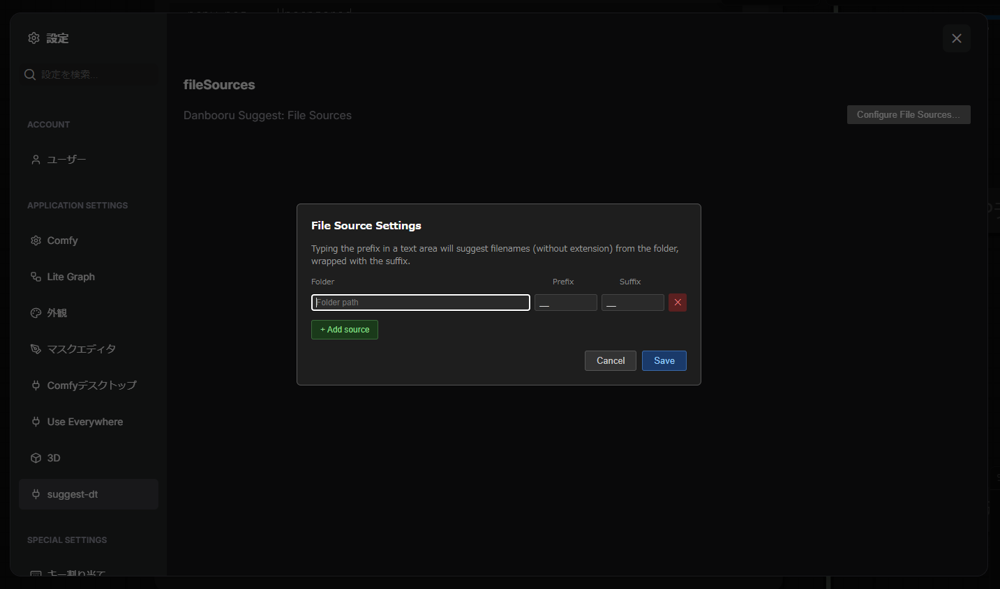

# comfyui-suggest-dt

Danbooru tag autocomplete for every text area in ComfyUI — works with both the classic LiteGraph canvas and the new Nodes 2.0 (Vue) frontend.

Inspired by [pythongosssss/ComfyUI-Custom-Scripts](https://github.com/pythongosssss/ComfyUI-Custom-Scripts) and [DominikDoom/a1111-sd-webui-tagcomplete](https://github.com/DominikDoom/a1111-sd-webui-tagcomplete).

[日本語版 README はこちら](README_jp.md)

---

## Features

- **Danbooru tag suggestions** — autocomplete as you type in any multiline text widget
- **Category colour coding** — General / Artist / Copyright / Character / Meta tags are colour-coded following Danbooru's scheme
- **Alias matching** — searching `/lh` finds `long_hair`, etc.
- **Wiki tooltip** — hover the `?` button on a suggestion to preview the Danbooru wiki entry inline; click to open the full page in a new tab
- **File sources** — configure local folders of `.txt` / `.yaml` files (wildcards, styles, etc.) to be suggested with a custom prefix/suffix (e.g. `__emotion__`)
- **Nodes 2.0 compatible** — uses a `MutationObserver` on the DOM, so it works regardless of which rendering system ComfyUI uses

---

## Installation

### Via ComfyUI Manager
Search for **comfyui-suggest-dt** and install.

### Manual
```bash
cd ComfyUI/custom_nodes
git clone https://github.com/your-username/comfyui-suggest-dt
```

Restart ComfyUI. On first launch the tag data (`danbooru.csv`, ~100 k tags) is downloaded automatically in the background.

---

## Usage

### Danbooru tag autocomplete

Type at least **2 characters** in any text widget. A dropdown will appear near the cursor showing matching tags, sorted by post count.

| Key | Action |
|-----|--------|
| `↑` / `↓` | Move selection |
| `Tab` or `Enter` | Insert selected tag (appends `, `) |
| `Escape` | Close dropdown |

A `?` button appears on each suggestion:

- **Hover** — preview the Danbooru wiki entry in a tooltip
- **Click** — open `danbooru.donmai.us/wiki_pages/{tag}` in a new browser tab

### File sources

Configure folders whose filenames are suggested with a custom prefix/suffix — useful for wildcard systems like [comfyui-promptcraft](https://github.com/your-username/comfyui-promptcraft).

Open **Settings → suggest-dt → Configure File Sources…**



| Field | Description |
|-------|-------------|
| **Folder** | Absolute path to the folder containing `.txt` / `.yaml` / `.yml` files |
| **Prefix** | Text prepended to the filename on suggestion (e.g. `__`) |
| **Suffix** | Text appended to the filename on selection (e.g. `__`) |

**Example:** With folder `/wildcards`, prefix `__`, suffix `__`:
- typing `__emot` → suggests `__emotion__`, `__emotional__`, …
- selecting inserts `__emotion__, ` into the text

File source suggestions take **priority over danbooru tags** when the current word starts with a registered prefix.

---

## Data

Tag data is sourced from [a1111-sd-webui-tagcomplete](https://github.com/DominikDoom/a1111-sd-webui-tagcomplete)'s `danbooru.csv` (top ~100 k Danbooru tags, format: `name, category, count, "aliases"`).

The file is cached at `data/danbooru.csv` and is **not** re-downloaded on subsequent restarts. To force a refresh, delete the file and restart ComfyUI.

User file-source configuration is stored at `data/file-sources.json`.

---

## Requirements

- ComfyUI (LiteGraph or Nodes 2.0 frontend)
- Python 3.10+
- `aiohttp` (bundled with ComfyUI)
